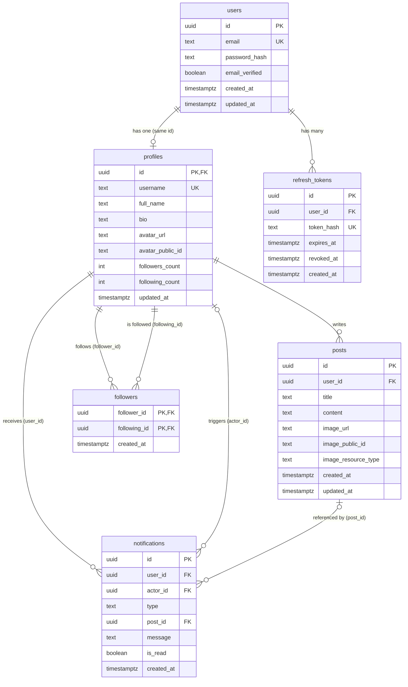

# News Share: Database Design

PostgreSQL 16 (local), accessed from NestJS through Prisma 6. This replaces the Supabase database (`auth.users`, RLS, triggers, RPC functions, storage buckets).

**Core idea:** the database stores relational data and **image references only** (`url` + `public_id`). The image files themselves live on Cloudinary.

---

## 1. Overview

| Item | Value |
|---|---|
| Engine | PostgreSQL 16 (Docker, local) |
| Access layer | Prisma 6 (`prisma/schema.prisma` is the source of truth) |
| Tables | 6: `users`, `refresh_tokens`, `profiles`, `posts`, `followers`, `notifications` |
| Primary keys | UUID (`gen_random_uuid()`), same IDs kept when migrating from Supabase |
| Timestamps | `timestamptz` (UTC) |
| Naming | snake_case in the database, camelCase in Prisma and the API |
| Image storage | Cloudinary; DB holds URL + public ID |
| Business rules | Enforced in NestJS services (no triggers, no RLS) |

### What changed from Supabase

| Supabase | New design |
|---|---|
| `auth.users` (managed by Supabase) | `users` table owned by the app |
| Supabase Auth sessions | `refresh_tokens` table (hashed, rotating) |
| RLS policies | Ownership checks in NestJS services |
| `handle_new_user` trigger | `AuthService.register` creates user and profile in one transaction |
| Follower-count trigger | Counters updated in a Prisma transaction |
| Notification triggers | Server-side event listeners |
| `follow_user` / `unfollow_user` RPC | `POST` / `DELETE /users/:id/follow` |
| `user_posts` view | Prisma query: post with `author` included |
| Storage buckets `avatars`, `posts` | Cloudinary folders; DB stores `*_url` and `*_public_id` |

---

## 2. Entity-relationship diagram



In words:

- A **user** (login identity) has exactly one **profile** (public identity). They share the same UUID.
- A profile writes many **posts**.
- **followers** is a many-to-many self-relationship on profiles (who follows whom).
- A profile receives many **notifications**; each may name an **actor** (who caused it) and a **post**.

---

## 3. Table definitions

### 3.1 `users` (replaces `auth.users`)

Login identity. Never exposed to other users.

| Column | Type | Null | Default | Notes |
|---|---|---|---|---|
| `id` | uuid | no | `gen_random_uuid()` | PK. Kept from Supabase on import |
| `email` | text | no | | Unique; stored **lowercase** by the service |
| `password_hash` | text | no | | argon2id. Imported Supabase bcrypt hashes are accepted and re-hashed on first login |
| `email_verified` | boolean | no | `false` | Reserved for a future verification flow |
| `created_at` | timestamptz | no | `now()` | |
| `updated_at` | timestamptz | no | auto | Maintained by Prisma `@updatedAt` |

### 3.2 `refresh_tokens`

Server-side record of issued refresh tokens (enables logout and rotation).

| Column | Type | Null | Default | Notes |
|---|---|---|---|---|
| `id` | uuid | no | `gen_random_uuid()` | PK |
| `user_id` | uuid | no | | FK → `users.id`, `ON DELETE CASCADE` |
| `token_hash` | text | no | | Unique. SHA-256 of the token; the raw token is never stored |
| `expires_at` | timestamptz | no | | Now + 30 days |
| `revoked_at` | timestamptz | yes | | Set on logout or rotation |
| `created_at` | timestamptz | no | `now()` | |

A token is valid only if it exists, `revoked_at IS NULL`, and `expires_at > now()`.

### 3.3 `profiles`

Public user data. `id` is both the primary key and a foreign key to `users.id` (one-to-one).

| Column | Type | Null | Default | Notes |
|---|---|---|---|---|
| `id` | uuid | no | | PK and FK → `users.id`, `ON DELETE CASCADE` |
| `username` | text | no | | Unique (case-insensitive check in the service). Pattern `^[a-zA-Z0-9_]{3,20}$` |
| `full_name` | text | yes | | Max 80 chars (DTO) |
| `bio` | text | yes | | Max 300 chars (DTO) |
| `avatar_url` | text | yes | | Cloudinary `secure_url` |
| `avatar_public_id` | text | yes | | Cloudinary `public_id` (server-side only; used to replace/delete) |
| `followers_count` | integer | no | `0` | Denormalized; number of rows in `followers` where `following_id = id` |
| `following_count` | integer | no | `0` | Denormalized; number of rows where `follower_id = id` |
| `updated_at` | timestamptz | no | auto | |

### 3.4 `posts`

| Column | Type | Null | Default | Notes |
|---|---|---|---|---|
| `id` | uuid | no | `gen_random_uuid()` | PK |
| `user_id` | uuid | no | | FK → `profiles.id`, `ON DELETE CASCADE` (the author) |
| `title` | text | yes | | Max 150 chars (DTO) |
| `content` | text | yes | | Max 5000 chars (DTO) |
| `image_url` | text | yes | | Cloudinary `secure_url`; returned to clients as `imageUrl` |
| `image_public_id` | text | yes | | Cloudinary `public_id`; **never returned** by the API |
| `image_resource_type` | text | no | `'image'` | Cloudinary resource type; keeps delete calls correct if other file types are added |
| `created_at` | timestamptz | no | `now()` | |
| `updated_at` | timestamptz | no | auto | |

Rule: a post must have a non-empty `title`, `content` or `image_url` (checked in `PostsService`).

### 3.5 `followers`

One row = "`follower_id` follows `following_id`".

| Column | Type | Null | Default | Notes |
|---|---|---|---|---|
| `follower_id` | uuid | no | | FK → `profiles.id`, `ON DELETE CASCADE` |
| `following_id` | uuid | no | | FK → `profiles.id`, `ON DELETE CASCADE` |
| `created_at` | timestamptz | no | `now()` | |

Primary key: **(`follower_id`, `following_id`)**, which prevents duplicate follows. A user cannot follow themselves (checked in `FollowsService`).

### 3.6 `notifications`

| Column | Type | Null | Default | Notes |
|---|---|---|---|---|
| `id` | uuid | no | `gen_random_uuid()` | PK |
| `user_id` | uuid | no | | Recipient. FK → `profiles.id`, `ON DELETE CASCADE` |
| `actor_id` | uuid | yes | | Who triggered it. FK → `profiles.id`, `ON DELETE SET NULL` |
| `type` | text | no | | `'follow'` or `'new_post'` (validated in code) |
| `post_id` | uuid | yes | | FK → `posts.id`, `ON DELETE CASCADE`. Set for `new_post` |
| `message` | text | yes | | Display text |
| `is_read` | boolean | no | `false` | |
| `created_at` | timestamptz | no | `now()` | |

| `type` | Created when | `actor_id` | `post_id` | `message` |
|---|---|---|---|---|
| `follow` | Someone newly follows the recipient | the follower | null | "You have a new follower!" |
| `new_post` | Someone the recipient follows posts | the author | the new post | "A user you follow posted something new!" |

Unfollowing creates no notification.

---

## 4. Relationships and delete behavior

| Parent → Child | Relationship | On delete of parent |
|---|---|---|
| `users` → `profiles` | 1 : 0..1 | CASCADE (profile removed) |
| `users` → `refresh_tokens` | 1 : many | CASCADE |
| `profiles` → `posts` | 1 : many | CASCADE |
| `profiles` → `followers` (as follower) | 1 : many | CASCADE |
| `profiles` → `followers` (as following) | 1 : many | CASCADE |
| `profiles` → `notifications` (as recipient) | 1 : many | CASCADE |
| `profiles` → `notifications` (as actor) | 1 : many | SET NULL (notification kept, actor becomes null) |
| `posts` → `notifications` | 1 : many | CASCADE (notification disappears with the post) |

**Cloudinary caveat:** database cascades remove rows only, not Cloudinary files. Before deleting a post or account, the service must delete the related Cloudinary assets (`posts.image_public_id`, `profiles.avatar_public_id`, and every image of the user's posts). `StorageService.safeDelete` does this for single assets; an account-deletion feature must loop over the user's posts first.

**Counter caveat:** cascade-deleting a profile removes its `followers` rows without running the counter update, so the *other* users' counters become stale. An account-deletion feature must decrement those counters in the same transaction (or run the reconcile script afterwards).

---

## 5. Constraints and where they are enforced

| Rule | Enforced by |
|---|---|
| Unique email | DB unique index on `users.email` (service lowercases first) |
| Unique username | DB unique index on `profiles.username`; service pre-checks case-insensitively and DB catches races (`P2002` → 409) |
| Username format `^[a-zA-Z0-9_]{3,20}$` | DTO `@Matches` |
| One follow per pair | DB composite primary key |
| No self-follow | `FollowsService` (400) |
| Post has title, content or image | `PostsService` (400) |
| Counters never negative | Service increments/decrements only on real insert/delete |
| `notifications.type` in (`follow`, `new_post`) | Code constants (only the listener creates notifications) |
| Only the owner edits or deletes a post | `PostsService` (403) |
| Only the recipient reads or changes a notification | Queries always filter `userId = currentUser` |
| Only the account owner changes a profile or avatar | Routes act on the JWT user only |

Prisma cannot express `CHECK` constraints or case-insensitive unique indexes in its schema, so these rules live in the application. If you later want database-level backing, add a `CHECK (follower_id <> following_id)` and a unique index on `lower(username)` through a custom migration.

---

## 6. Indexes

| Index | Columns | Serves |
|---|---|---|
| PK `users` | `id` | Lookups by id |
| UNIQUE `users_email_key` | `email` | Login by email |
| UNIQUE `refresh_tokens_token_hash_key` | `token_hash` | Refresh and logout lookups |
| `refresh_tokens_user_id_idx` | `user_id` | Revoking all tokens of a user |
| UNIQUE `profiles_username_key` | `username` | Username availability, profile by username |
| `posts_user_id_created_at_idx` | `user_id`, `created_at DESC` | "Posts by user", feed (`user_id IN (...)` newest first) |
| `posts_created_at_id_idx` | `created_at DESC`, `id DESC` | Global timeline with stable cursor ordering |
| PK `followers` | `follower_id`, `following_id` | "Who do I follow", follow-status, duplicate prevention |
| `followers_following_id_created_at_idx` | `following_id`, `created_at DESC` | "My followers" list, fan-out on new post |
| `notifications_user_id_created_at_idx` | `user_id`, `created_at DESC` | Notification list |
| `notifications_user_id_is_read_idx` | `user_id`, `is_read` | Unread count and unread filter |

---

## 7. Image storage mapping

| What | Where it lives |
|---|---|
| Image bytes | Cloudinary |
| Public URL (what Flutter loads) | `posts.image_url`, `profiles.avatar_url` |
| Cloudinary public ID (for delete/replace) | `posts.image_public_id`, `profiles.avatar_public_id` |

Cloudinary layout:

```
news_share/
├── avatars/{userId}            # fixed public_id per user; re-upload overwrites
└── posts/{userId}/{uuid}       # one asset per post image
```

Rules:

- The database never stores image bytes.
- `*_public_id` columns are internal. API responses expose only the URLs.
- Replacing a post image: upload new, update row, delete old asset.
- Deleting a post: delete row, then delete the Cloudinary asset.

---

## 8. Denormalized counters

`profiles.followers_count` and `profiles.following_count` avoid counting `followers` rows on every profile view.

| Event | Effect (inside one Prisma transaction) |
|---|---|
| Follow A → B (new row) | `A.following_count + 1`, `B.followers_count + 1` |
| Follow again (row exists) | Nothing changes (idempotent) |
| Unfollow A → B (row deleted) | `A.following_count − 1`, `B.followers_count − 1` |
| Unfollow when not following | Nothing changes |

Repair script: recompute both counters from `followers` with a `groupBy` (`scripts/reconcile-follow-counts.ts`). Run it after bulk imports and any time counters are suspected to drift.

---

## 9. Main access patterns

| Use case | Query shape | Index used |
|---|---|---|
| Login | `users` by `email`, include `profile` | unique email |
| Validate refresh token | `refresh_tokens` by `token_hash` | unique token hash |
| Profile by id | `profiles` by `id` | PK |
| Search users | `profiles` where `username` or `full_name` contains term (case-insensitive) | scan; add a trigram index if the table grows large |
| Create post | insert `posts` | PK |
| Global timeline | `posts` order by `created_at DESC, id DESC`, `take n+1`, include author | `posts_created_at_id_idx` |
| Posts by user | `posts` where `user_id = ?` order by `created_at DESC` | `posts_user_id_created_at_idx` |
| Feed | ids from `followers` where `follower_id = me`, then `posts` where `user_id IN (me, ...ids)` | PK on followers, `posts_user_id_created_at_idx` |
| Follow status | two lookups by composite key | PK |
| My followers | `followers` where `following_id = ?` order by `created_at DESC` | `followers_following_id_created_at_idx` |
| Who I follow | `followers` where `follower_id = ?` | PK prefix |
| Notification list | `notifications` where `user_id = me` order by `created_at DESC` | `notifications_user_id_created_at_idx` |
| Unread count | count where `user_id = me AND is_read = false` | `notifications_user_id_is_read_idx` |
| Fan-out on new post | `followers` where `following_id = author`, bulk insert notifications | `followers_following_id_created_at_idx` |

Pagination is cursor-based (the last row's id), never offset-based, so feeds stay stable while new posts arrive.

---

## 10. Prisma schema (source of truth)

```prisma
generator client {
  provider = "prisma-client-js"
}

datasource db {
  provider = "postgresql"
  url      = env("DATABASE_URL")
}

model User {
  id            String         @id @default(dbgenerated("gen_random_uuid()")) @db.Uuid
  email         String         @unique
  passwordHash  String         @map("password_hash")
  emailVerified Boolean        @default(false) @map("email_verified")
  createdAt     DateTime       @default(now()) @map("created_at") @db.Timestamptz(6)
  updatedAt     DateTime       @updatedAt @map("updated_at") @db.Timestamptz(6)

  profile       Profile?
  refreshTokens RefreshToken[]

  @@map("users")
}

model RefreshToken {
  id        String    @id @default(dbgenerated("gen_random_uuid()")) @db.Uuid
  userId    String    @map("user_id") @db.Uuid
  tokenHash String    @unique @map("token_hash")
  expiresAt DateTime  @map("expires_at") @db.Timestamptz(6)
  revokedAt DateTime? @map("revoked_at") @db.Timestamptz(6)
  createdAt DateTime  @default(now()) @map("created_at") @db.Timestamptz(6)

  user      User      @relation(fields: [userId], references: [id], onDelete: Cascade)

  @@index([userId])
  @@map("refresh_tokens")
}

model Profile {
  id             String   @id @db.Uuid
  username       String   @unique
  fullName       String?  @map("full_name")
  bio            String?
  avatarUrl      String?  @map("avatar_url")
  avatarPublicId String?  @map("avatar_public_id")
  followersCount Int      @default(0) @map("followers_count")
  followingCount Int      @default(0) @map("following_count")
  updatedAt      DateTime @updatedAt @map("updated_at") @db.Timestamptz(6)

  user               User           @relation(fields: [id], references: [id], onDelete: Cascade)
  posts              Post[]
  following          Follow[]       @relation("Follower")
  followers          Follow[]       @relation("Following")
  notifications      Notification[] @relation("Recipient")
  actedNotifications Notification[] @relation("Actor")

  @@map("profiles")
}

model Post {
  id                String   @id @default(dbgenerated("gen_random_uuid()")) @db.Uuid
  userId            String   @map("user_id") @db.Uuid
  title             String?
  content           String?
  imageUrl          String?  @map("image_url")
  imagePublicId     String?  @map("image_public_id")
  imageResourceType String   @default("image") @map("image_resource_type")
  createdAt         DateTime @default(now()) @map("created_at") @db.Timestamptz(6)
  updatedAt         DateTime @updatedAt @map("updated_at") @db.Timestamptz(6)

  author            Profile        @relation(fields: [userId], references: [id], onDelete: Cascade)
  notifications     Notification[]

  @@index([userId, createdAt(sort: Desc)])
  @@index([createdAt(sort: Desc), id(sort: Desc)])
  @@map("posts")
}

model Follow {
  followerId  String   @map("follower_id") @db.Uuid
  followingId String   @map("following_id") @db.Uuid
  createdAt   DateTime @default(now()) @map("created_at") @db.Timestamptz(6)

  follower    Profile  @relation("Follower", fields: [followerId], references: [id], onDelete: Cascade)
  following   Profile  @relation("Following", fields: [followingId], references: [id], onDelete: Cascade)

  @@id([followerId, followingId])
  @@index([followingId, createdAt(sort: Desc)])
  @@map("followers")
}

model Notification {
  id        String   @id @default(dbgenerated("gen_random_uuid()")) @db.Uuid
  userId    String   @map("user_id") @db.Uuid
  actorId   String?  @map("actor_id") @db.Uuid
  type      String
  postId    String?  @map("post_id") @db.Uuid
  message   String?
  isRead    Boolean  @default(false) @map("is_read")
  createdAt DateTime @default(now()) @map("created_at") @db.Timestamptz(6)

  recipient Profile  @relation("Recipient", fields: [userId], references: [id], onDelete: Cascade)
  actor     Profile? @relation("Actor", fields: [actorId], references: [id], onDelete: SetNull)
  post      Post?    @relation(fields: [postId], references: [id], onDelete: Cascade)

  @@index([userId, createdAt(sort: Desc)])
  @@index([userId, isRead])
  @@map("notifications")
}
```

Apply with:

```bash
npx prisma migrate dev --name init
npx prisma generate
```

---

## 11. Data lifecycle

| Event | Rows affected |
|---|---|
| Register | 1 `users` + 1 `profiles` (single transaction) + 1 `refresh_tokens` |
| Login / refresh | New `refresh_tokens` row; on refresh the old row gets `revoked_at` |
| Logout | `revoked_at` set on the presented refresh token |
| Update profile | `profiles` row; avatar change also updates `avatar_url` and `avatar_public_id` |
| Create post | 1 `posts`; then 1 `notifications` row per follower (`new_post`) |
| Delete post | `posts` row removed; its `notifications` cascade; Cloudinary asset deleted by the service |
| Follow (new) | 1 `followers`; both counters +1; 1 `notifications` (`follow`) |
| Unfollow | `followers` row removed; both counters −1 |
| Mark notification read | `is_read = true` on the recipient's row |
| Delete account (future) | Delete Cloudinary assets and fix other users' counters first, then delete `users`; everything else cascades |

Housekeeping suggestion: periodically delete `refresh_tokens` where `expires_at < now()` or `revoked_at` is older than 30 days.

---

## 12. Sample data (illustrative)

`users` / `profiles`

| id | email | username | full_name | followers | following |
|---|---|---|---|---|---|
| `u-1` | ada@example.com | ada_l | Ada Lovelace | 1 | 0 |
| `u-2` | bob@example.com | bob_b | Bob Builder | 0 | 1 |

`followers`

| follower_id | following_id | created_at |
|---|---|---|
| `u-2` | `u-1` | 2026-11-15T09:00:00Z |

`posts`

| id | user_id | title | image_url | image_public_id |
|---|---|---|---|---|
| `p-1` | `u-1` | Hello | https://res.cloudinary.com/demo/image/upload/v1/news_share/posts/u-1/p-1.jpg | news_share/posts/u-1/p-1 |

`notifications`

| id | user_id | actor_id | type | post_id | is_read |
|---|---|---|---|---|---|
| `n-1` | `u-1` | `u-2` | follow | null | false |
| `n-2` | `u-2` | `u-1` | new_post | `p-1` | false |

---

## 13. Migration mapping from Supabase

| Supabase source | New target | Transformation |
|---|---|---|
| `auth.users.id` | `users.id` | Same UUID |
| `auth.users.email` | `users.email` | Lowercase |
| `auth.users.encrypted_password` | `users.password_hash` | Copied as-is (bcrypt); re-hashed to argon2 on first login |
| `auth.users.created_at` | `users.created_at` | Copied |
| `public.profiles.*` | `profiles.*` | Same columns; `avatar_public_id` filled by the Cloudinary migration script |
| `public.posts.*` | `posts.*` | Same columns plus `updated_at`, `image_public_id`, `image_resource_type` |
| `public.followers.*` | `followers.*` | Drop self-follow rows |
| `public.notifications.*` | `notifications.*` | Same columns |
| Supabase Storage objects | Cloudinary | Re-uploaded by URL; URLs and public IDs rewritten |

Import order (foreign keys): `users` → `profiles` → `posts` → `followers` → `notifications`. Then run the counter reconcile script and the Cloudinary file migration.

Pre-import data checks:

- Usernames that violate the pattern or collide when compared case-insensitively.
- Emails that collide after lowercasing.
- Posts with no title, content or image.
- Self-follows and orphaned rows (references to missing profiles or posts).

---

## 14. Scaling notes

- **Search:** `contains` queries scan the table. If profiles grow large, add a trigram (`pg_trgm`) index in a custom migration.
- **Fan-out:** the `new_post` bulk insert is fine for thousands of followers; for very large authors, move it to a queue and batch the inserts.
- **Feed:** the `IN (...)` query over followed users is adequate early on. If it gets slow, introduce a per-user feed table.
- **Retention:** archive or delete old read notifications on a schedule.
- **Backups:** `pg_dump -Fc` on a schedule; test restores.
